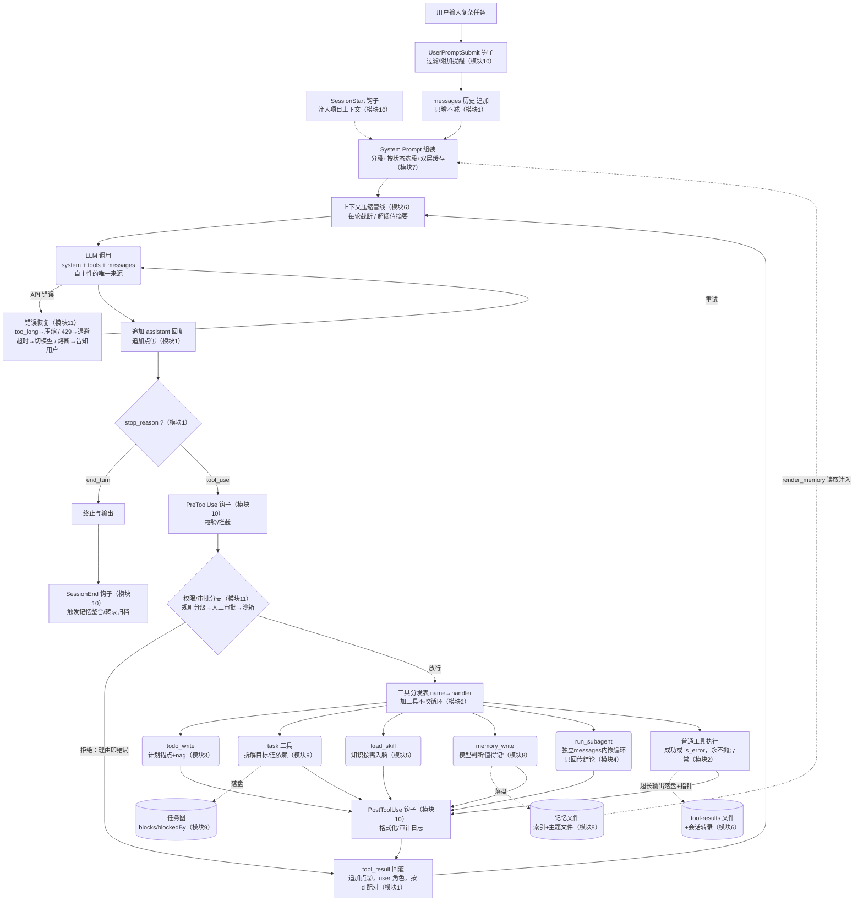

# Agent Harness 端到端全景图 · 学习收官（模块 12）

> 前 11 个模块的局部图在此拼合。用法（大纲的三步）：先读图 → 打开 `agents/s_full.py` 对照读码，每读一段在图上找到位置 → 合上代码只看图口述全流程，再回查遗漏。

## 1. 全景图（Mermaid）

图例：**矩形 = harness 机制**（确定性代码）；**圆角 = 模型决策点**（LLM 的语言/判断活）；**菱形 = 分支裁决**（harness 读取信号做路由）；**圆柱 = 持久层**（活过会话的世界状态）。

主干一句话：**messages 只增地累积经历，system prompt 每轮如实重生，压缩管线把守入口，LLM 是唯一的决策者，stop_reason 分岔出"继续干"和"交卷"，每个动作过三道关（Pre 钩子→权限→Post 钩子），一切结局都以 tool_result 回到循环。**

## 2. 逐节点：谁触发 / 谁执行 / model 在此的角色

| 节点 | 谁触发 | 谁执行 | model 的角色 |
|---|---|---|---|
| SessionStart / SessionEnd | harness（生命周期事件） | harness（脚本） | 无感知，只见注入的结果 |
| UserPromptSubmit | 用户输入到达 | harness | 无感知 |
| messages 追加（①②两点） | API 返回 / 工具完成 | harness | 内容的作者（①）或读者（②） |
| System Prompt 组装 | harness 每轮点名 | harness（缓存命中则免拼） | 被塑造者——"自我"由状态推导，模型可经记忆/技能**间接**影响（提议→裁决→执行） |
| 压缩管线 | harness（每轮/阈值/报错） | harness 决策，摘要雇 LLM | 写摘要时是受雇的语言工人，平时无感知 |
| LLM 调用 | harness | 模型 | **全图唯一的自主决策源**：做什么、调什么、何时交卷 |
| 错误恢复 | API 异常 | harness（分类+重试+熔断） | 无感知（天气不占心智）；工具层错误例外——回灌给它自救 |
| stop_reason 分支 | API 返回 | harness 读信号 | 信号的发出者（用结构化字段而非文本约定） |
| PreToolUse / 权限审批 | tool_use 出现 | harness 规则 + 人类闸门 + 沙箱 | 被约束者；拒绝理由回灌后是学习者（改道不鬼打墙） |
| 工具分发与执行 | harness 查表 | handler（本地函数或 MCP 转发） | 决策者（选哪个工具、填什么参数）但碰不到执行 |
| Todo | 模型主动调用 | harness 存储/渲染/nag | 计划的作者；nag 时的被提醒者 |
| Task 任务图 | 模型拆解/认领 | harness CRUD+环检测+ready 计算 | 目标的规划者；图是人机共享的协调面 |
| Skills 加载 | 模型看目录后主动拉 | harness 读文件回灌 | 判断"该学哪门手艺"的人（pull，决策可审计） |
| 记忆写 / 读 | 写：模型；读：harness 开局注入 | 写：handler 落盘；整合：harness 雇 LLM；读：render_memory | 写时判断"值得记"（语义活）；读时是无感的受益者 |
| 子 agent | 模型派发（写自包含 prompt） | harness 起内嵌循环 | 派发方是语境翻译者；子方是一次性心智 |
| tool_result 回灌 | 工具/审批出结局 | harness 包装（id 配对+is_error） | 下一轮的读者——它的世界图景由此更新 |
| 终止与输出 | stop_reason=end_turn | harness 收尾 | 交卷人 |

## 3. 对照附录 A 自检清单

大纲附录 A 的 17 项元素在图中的位置：用户输入→INIT ✓；System Prompt 组装 ✓（SP）；压缩管线位于 LLM 前 ✓（CP）；LLM 调用 ✓；stop_reason 分支 ✓（SR）；分发表 ✓（DIS）；工具错误回灌不崩溃 ✓（T6→TR）；tool_result 回到循环 ✓（TR→CP）；Todo ✓（T1）；Task 持久图 ✓（T2/TASK）；子 agent 派发回收 ✓（T5）；技能按需加载 ✓（T3）；记忆读写 ✓（MEM 两条边：读走注入、写走工具）；Hooks 挂点 ✓（SS/UPS/PRE/POST/SE）；错误恢复分支 ✓（ER）；权限审批分支 ✓（PERM）；终止输出 ✓（OUT）。

学习中自创、图上也画进去的增量：**双追加点**（APP/TR）、**载荷落盘+指针**（FS：tool-results + 转录）、**审批拒绝的结局协议**（PERM 的拒绝边直通 TR——墙挡手不抹记忆）。

## 4. 读码指引（验收目标 A）

打开 `agents/s_full.py`，按图索骥的顺序建议：① 找到 while 主循环和两个 messages.append ——主干立住；② 找 stop_reason 分支和分发表——图的右半边；③ 找压缩函数被调用的位置（应在 LLM 调用前）——CP 的位置感；④ 找 todo/task/skill/memory/subagent 各自的 handler——确认"它们都只是工具"；⑤ 找错误处理 try 包在哪一层——分清"回灌给模型"和"harness 自己扛"两类。每读到一段问三个问题：这属于图上哪个节点？解决什么问题？model 在这里是决策者、受益者还是被约束者？全部答得出，验收目标 A 达成。

## 5. 最终自测（验收目标 B）

合上此图，白纸口述或重画：从"用户说'帮我调研竞品并写份报告'"开始，走完一个包含**技能加载、子 agent 派发、一次审批拒绝、一次上下文压缩、一次记忆写入**的完整生命周期，说清每一步谁在动、动的是心智还是世界。画完对照本图查漏。缺哪个模块的边，回哪份文档。

---

## 6. 追问与深挖（读图时的延伸问题）

### 6.1 SessionStart 注入的是什么上下文？

**"开局情报"——让一个刚出生的心智知道自己降生在什么世界里**。四类：① **项目级约定与进度**：CLAUDE.md 全文（"新员工入职手册"：项目干什么、有什么规矩、进行到哪——每次新会话 agent"记得"学习进度就是这个机制）；② **环境快照**：工作目录与结构概要、git 状态（分支/最近提交/未提交改动）、操作系统、日期——"你站在哪"的物理事实，且**只能开局采集**（中途要最新状态得自己调工具查，注入的是快照不是订阅）；③ **续作上下文**：上次会话收尾摘要、任务图"进行到 T3"的状态（模块 9 跨会话续作的入口）；④ **管理面注入**：企业管理员配置的合规提示、组织策略（钩子作为管理员扩展面的最常用挂点）。

两个边界：**与记忆读取的区别**——记忆是跨项目跟着用户走的长期沉淀，SessionStart 注入的是这个项目、这个工作区的当场情报；实现上常同时发生，但来源和生命周期不同，图上分开画。**与 UserPromptSubmit 的区别**——SessionStart 每会话一次（注入"世界是什么样"），UserPromptSubmit 每条消息一次（"这句话要不要过滤/附加什么"）：一个是接机举牌，一个是每次进门安检。

### 6.2 SessionStart 本质上就是组装 system prompt 吗？

不是——**SessionStart 是备料和开工仪式，组装是下锅**。四条分界：

① **节奏**：SessionStart 每会话一次；组装每轮点名（多数命中缓存）。合并 = 每轮重跑"读 CLAUDE.md、查 git、扫目录"这些又慢又贵的采集——**贵的采集干一次，便宜的比对每轮干**，备料间和灶台要分开。② **职责**：SessionStart 的杂活远不止喂 system prompt——检查环境健康、清理临时文件、恢复任务图、预热缓存、记审计日志，这些副作用与 system prompt 无关，是世界层面的开工准备。③ **产物去向不止一个通道**：一部分写进 ctx 等组装拼进 system prompt（CLAUDE.md→项目段），另一部分直接注入 messages（如上次会话摘要——更像事件）。备好的料按性质分流两个通道（路由表），所以它必须站在分岔口之前。④ **所有权**：组装函数是 harness 核心代码；SessionStart 是留给用户/管理员的扩展面——核心机制和扩展点从来是两层。

分工链三段：**SessionStart 备料**（一次性、有副作用、可扩展）→ **build_context 点名**（每轮读状态，便宜）→ **assemble 下锅**（按状态拼段，缓存罩着）。记忆钩子：SessionStart 是**出生时的产检和上户口**（一次性，定了你降生在哪个世界），组装是**每天早上照镜子确认自己是谁**（例行但便宜）——把上户口合并进每天照镜子，显然不对劲。